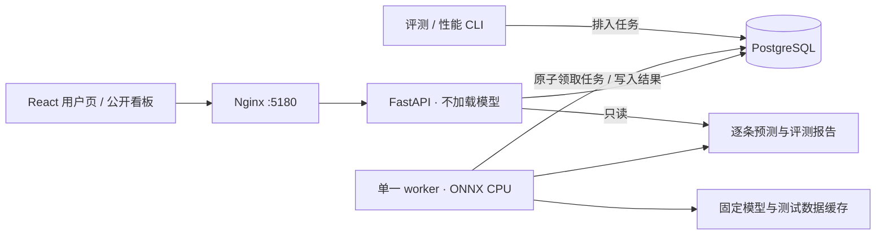

# Campus Notes · 校园回声

带英文文本情绪分析的校园活动评论平台，DML 课程 MVP。React + TypeScript / FastAPI / PostgreSQL / ONNX Runtime CPU / Docker Compose。

**当前为公开、免密码演示**：输入用户名即可进入，用户页与分析看板可自由切换，任何访客均可收藏、标记处理及追加人工纠正。它没有受保护的管理员角色，也不验证真实身份。仅使用虚构活动与演示内容；这是按项目要求选择的产品模式。

本次实际运行结果与截图见 [本地验收记录](docs/validation.md)。

## 本地运行

需要 Docker Desktop（运行中）、Docker Compose v2；前端单独开发时需要 Node.js 22.12+ 和 npm，初始化脚本需要 Python 3。后端的 Python 3.12 由容器提供，不使用宿主机的默认 Python。

```sh
git clone https://github.com/Zejun-Derry-Xu/sentiment-analysis.git
cd sentiment-analysis
sh scripts/setup.sh
```

打开 **http://localhost:5180**。首次启动下载作者已经发布的 125 MB INT8 ONNX 权重；无需 Hugging Face token。页面可以先打开，模型就绪前评论保持等待状态。查看状态：

```sh
docker compose ps
docker compose logs --tail 50 worker
curl -f http://localhost:5180/ready
```

`scripts/setup.sh` 只在 `.env` 不存在时生成随机数据库密码，文件权限为 600。活动由版本化数据库初始化程序幂等写入。演示用户例如 `Alex`、`Jordan`，无需预置账号、无需密码。可选填充六条虚构演示评论（幂等执行，实际进入推理队列，不预填模型结果）：

```sh
docker compose --profile tools run --rm cli python -m app.cli seed-demo
```

同一浏览器保留 30 天 HttpOnly 会话 cookie。“我的评论”和收藏按该会话关联。不同浏览器输入同一个名字也不是同一身份；主动退出会撤销会话，同名重新进入不能恢复原来的个人视图。所有评论仍在公开看板中。

### 常用操作

```sh
# 重新构建并启动，保留数据库与模型缓存
docker compose up -d --build
# 停止本项目，保留全部命名卷；不要添加 -v
docker compose down
# 重新启动既有容器
docker compose start
# 查看日志
docker compose logs --tail 100 api worker
```

`compose.yaml` 固定项目名 `dml-campus-emotions`，独立数据库、网络和卷。默认只绑定本机 `127.0.0.1:5180`；API、PostgreSQL 不发布宿主机端口。

## 演示流程

1. 以 `Alex` 进入，打开“草坪音乐夜”。
2. 发布：`The music was amazing! Thank you for organizing this.`
3. 确认评论先保存，随后从等待／分析中变为分析完成。展开全部 28 项得分。
4. 再发布：`I was disappointed by the long wait, but I loved the performances.`；观察最高分标签和阈值集合。
5. 切到“分析看板”，按活动、模型情绪、分析状态、处理状态或日期筛选。
6. 收藏一条评论，在“我的收藏”找到它；标记“已查看”或“已处理”。
7. 点击“人工纠正”，选择一个或多个标签并说明理由。查看独立纠正记录以及未改变的模型输出。
8. 打开“评测报告”，查看官方成绩、全部类别结果、下载逐条预测与运行信息。

模型标签仅描述文字中表达的情绪；不推断心理状态，不代表违规，不自动删帖或封禁。

## 架构与数据



评论提交事务同时保存评论和任务，HTTP 返回 202。前端每 3 秒轮询。状态为 `pending → processing → completed / failed`。后台失败最多自动尝试三次，之后保留评论并允许手动重试。每次分析单独记录；人工纠正从不修改分析表。数据库原子锁防止重复领取，5 分钟任务租约用于恢复中断工作，单例 advisory lock 防止多个 worker 重复加载模型。

数据库包含 `users`、`sessions`、`events`、`comments`、`jobs`、`analyses`、`runtimes`、`favorites`、`handling_history`、`corrections`、`evaluations`、`benchmarks`。`schema_migrations` 记录迁移版本；版本 1 的 SQL 在 `backend/app/schema.sql`，初始化入口为 `python -m app.cli init`。未来结构调整应追加迁移版本，不能改写已应用迁移来升级既有数据库。

API 契约由 FastAPI 生成，可访问 `/api/openapi.json`，核心接口：

| 接口 | 行为 |
|---|---|
| `POST/GET/DELETE /api/session` | 输入用户名、读取身份、撤销会话 |
| `GET /api/events` | 真实数据库活动及评论数 |
| `POST /api/comments` | `event_id,text,idempotency_key`；事务保存并返回 202 |
| `GET /api/comments` | 分页、活动、阈值标签、状态、处理状态、带时区时间范围、mine、favorites |
| `GET /api/comments/{id}` | 原始分析、所有纠正记录、处理历史和分析尝试 |
| `POST /api/comments/{id}/retry` | 仅失败评论可重试，保留历史 |
| `PUT /api/comments/{id}/favorite` | `{value: true/false}`；当前浏览器身份的收藏 |
| `PUT /api/comments/{id}/handling` | `{status: unread/viewed/processed}`；公开操作并记录历史 |
| `POST /api/comments/{id}/corrections` | `{labels: [...],reason: "..."}`；允许空集合 |
| `GET /api/evaluations` | 评测运行及指标，不开放网页启动昂贵评测 |
| `GET /api/evaluations/{id}/files/{filename}` | 下载指标、预测或元数据 |
| `GET /api/benchmarks` | 独立性能报告 |
| `GET /health`、`GET /ready` | 进程健康；数据库与近期 worker 心跳就绪 |

仅 `mine` 与收藏按会话隔离。看板操作故意对所有已输入用户名的访客开放；不能将这些测试描述为管理员授权测试。变更请求检查 Origin，cookie 设置 HttpOnly / SameSite=Lax。用户名 1–32 字，评论 1–2000 字，纠正理由最多 500 字；数据库参数化查询，React 按文本转义。情绪筛选指原始模型超过阈值的标签，不指最高分或人工纠正标签。

## 模型与数据来源

详见 [固定来源清单](docs/sources.json) 与 [第三方许可说明](licenses/NOTICE.md)。

| 资源 | Revision | 许可证 |
|---|---|---|
| [SamLowe ONNX](https://huggingface.co/SamLowe/roberta-base-go_emotions-onnx) | `90ee0c1c4796d370e68968687b8ba51fc11224f4` | MIT |
| [SamLowe 原始模型](https://huggingface.co/SamLowe/roberta-base-go_emotions) | `d75048347613a25d77de8cf6412eaae9fa7b26be` | MIT |
| [GoEmotions](https://huggingface.co/datasets/google-research-datasets/go_emotions) | `add492243ff905527e67aeb8b80c082af02207c3` | Apache-2.0 |

直接下载 `onnx/model_quantized.onnx`，实际 125,397,543 字节；SHA-256：`0c1981c5b479674747911c8e2228f0c4ec90bf47bf66e830f7d4fc62be082958`。**不训练、不微调、不量化、不做 baseline 或模型选择。**

直接使用 `tokenizers` 和 `onnxruntime`，无需安装 PyTorch 或 Optimum。模型输入为 int64 的 `input_ids`、`attention_mask`；batch size 1，无需 padding。RoBERTa tokenizer 使用同一固定 revision，最长 512 tokens，截断保留末尾 `</s>`。原始 ONNX 图输出 `logits [batch,28]`，包装代码仅应用一次 sigmoid，不使用 softmax。

按[作者评测代码](https://github.com/samlowe/go_emotions-dataset/blob/main/eval-roberta-base-go_emotions.ipynb)固定使用严格的 **score > 0.5**，不执行该 notebook 后面的阈值搜索。最高分标签独立展示；全部得分不超过阈值时返回空集合，不强行补 neutral。得分未经概率或心理测量校准。

GoEmotions simplified/test 实际为 5,427 条，来自人工标注的英文 Reddit 评论。下载时检查文件哈希、真实行数和全部 28 个标签映射。测试 Parquet 的 SHA-256 为 `fd0953e535ba2569edc6a1daaa1133f8e4b9071691d540c9bab812fda132bc26`。现场评论、性能测试评论和人工纠正不混入官方成绩。

## 分类评测与复现

先确保 worker 就绪：

```sh
sh scripts/evaluate.sh
# 可选：少量样本的运行冒烟测试，页面明确标记“非官方完整成绩”
sh scripts/evaluate.sh --limit 8
```

CLI 只排入任务，不加载第二个模型。worker 每处理 16 条评测样本，会让一条等待中的评论先运行。完整运行按固定原顺序处理所有 5,427 条，使用全部 28 个标签：

- micro-F1：整体标签预测的 F1。
- macro-F1：全部类别 F1 等权平均，零分母为 0，不排除表现差或 support 为 0 的类别。
- 每个类别的 Precision、Recall、F1、support；support 是该类的真实标签数量。
- exact-match accuracy：一条文本全部 28 位标签必须完全匹配，不是逐标签平均准确率。

报告持久化于 `reports` 命名卷内 `/reports/evaluations/<run-id>/`，包含 `metrics.json`、`metadata.json`、`predictions.jsonl`。数据库保存运行状态、进度、指标、版本及元数据。下载可用网页链接，或：

```sh
mkdir -p reports
docker compose cp worker:/reports/evaluations/. ./reports/evaluations/
# 用已保存预测重算指标，不重新推理
docker compose --profile tools run --rm cli python -m app.cli rescore /reports/evaluations/RUN_ID/predictions.jsonl
```

提交的本地完整评测快照位于 `docs/results/local-evaluation/`；数据库重建后，可以重新执行评测生成网页中的运行记录。作者报告与本地实测分别列出，不能将作者的准确率或速度当作本机成绩。

## 性能测量

在无其他待处理任务时运行：

```sh
sh scripts/benchmark.sh
```

模型阶段：固定测试集前 100 条原文、batch 1、额外预热 20 次，然后测量单条推理 p50/p95 和吞吐量。计时包含分词、ORT 推理和 sigmoid/标签处理，不含下载；模型加载、进程首次推理另记。正常 worker 启动时也预热 20 次。

API 阶段：同样 100 条文本分别以并发 1、4，通过真实 HTTP 请求、持久化、后台领取及推理完成。记录提交响应时间、数据库排队时间、单条推理时间、服务器保存到结果提交时间，以及客户端轮询观察到完成的时间。客户端每 100 ms 轮询，因此客户端完成时间包含轮询误差。吞吐量按每阶段全部完成的墙钟时间计算，不是仅 HTTP 202 接收速率。

CPU 百分比是推理区间的进程 CPU 时间 / 墙钟时间，100% 表示占满一个核；内存为每条推理后采样的 RSS，报告的最大值不是系统级瞬时峰值。报告保存文本字符/token 长度分布、架构、容器 CPU 配额、模型版本、包版本、ORT 线程和 runtime ID。默认只有一个模型进程，intra-op 2 / inter-op 1，容器限制 2 CPU、3 GB 内存。

基准流量写入独立 benchmark 活动，默认活动列表、看板、统计和官方分类评测均排除。请勿在性能测试同时发布评论或跑其他重任务；已提交本地报告位于 `docs/results/local-benchmark/`。**Mac 上 Docker 的 Linux/ARM64 结果不是 Jetstream2 的实测结果**，部署后应按相同入口重测。

## 测试和前端开发

```sh
sh scripts/test.sh
# 只运行后端测试（真实 PostgreSQL，独立 campus_test 数据库）
docker compose --profile tools run --rm tests
# 前端开发
npm ci
npm run dev
```

后端测试强制数据库名以 `_test` 结尾，重置只发生在测试数据库。覆盖真实事务、会话归属、公开看板、重复提交、筛选收藏、处理记录、纠正不可覆盖、失败重试、并发领取与租约恢复；纯指标测试覆盖 sigmoid、严格阈值、空集合及多标签指标。真实模型在整套 Compose 演示、完整评测及性能测试中验收。

开发前端默认代理到本机 8000；若单独运行 Vite，使用临时 Compose override 仅将 api 端口绑定到 `127.0.0.1:8000`，并在 `.env` 的 `APP_ORIGINS` 加上 Vite 实际地址。标准演示直接使用 Compose 打包后的页面，不需要开放 API 端口。

## 新 Jetstream2 实例部署

本地 MVP 完成后才部署；不操作旧 returnflow 实例。

1. 在新实例只读核查系统版本、CPU/内存/磁盘、Docker/Compose 和端口。
2. 将本仓库克隆至新的独立目录，例如 `~/sentiment-analysis`。不复制本地 `.env`，在新机器重新生成。
3. 先 `sh scripts/setup.sh`，默认只绑定服务器本机。访问可使用 SSH 隧道：`ssh -N -L 5180:127.0.0.1:5180 USER@NEW_HOST`。
4. 如需要公开课程演示，在 `.env` 设置 `APP_BIND=0.0.0.0`、适当的 `APP_PORT` 和精确的 HTTPS 入口 `APP_ORIGINS`。通过 HTTPS 代理访问时设置 `COOKIE_SECURE=true`。使用真实的新实例地址，不能复用历史 IP。
5. 验证健康、完整演示、重启持久化；在新虚拟机重新运行完整评测和性能测试，单独保存硬件结果。

不要将此公开模式作为真实校园系统上线。需要受保护后台时，应另行加入经过验证的身份和服务器端授权，而非依赖前端视图切换。

## 备份与限制

```sh
mkdir -p reports/backups
docker compose exec -T db pg_dump -U campus -d campus -Fc > reports/backups/campus.dump
```

数据库卷保存评论和运行记录；reports 卷保存逐条预测；assets 卷保存可重新下载的固定权重。备份数据库时也保留 reports 卷中的对应文件。普通重启不会删除这些卷。

模型来自 Reddit 英文语料，校园场景存在领域差异；讽刺、上下文不足、罕见情绪和多标签共现都可能造成错误。第一版不保证中文或其他非英文分析可靠；页面遇到明显中文会提示并阻止提交，但这不是完整语言检测器。阈值固定，无概率校准，不从现场反馈训练。公开看板中的纠正也不构成官方测试标签。

源代码采用 MIT；模型及数据保留各自许可证。大权重、数据库、会话、`.env` 不进入 Git。

## 双模型评论分析

默认 Compose 现在同时启动情绪与三分类两套 CPU 服务。在同一个活动页面发布英文评论后，分别显示 28 类多标签情绪、正面/中性/负面三分类及各自状态和模型得分。看板提供两套分布、三分类结果/状态筛选；分布统计全站非性能测试评论，不随列表筛选改变。情绪分布一条评论可以多计，三分类分布每条已完成评论只计一次。看板“已完成”要求两套均完成。

迁移 2 为已有评论自动排队补充三分类，不改动原始情绪分析。两个队列原子领取、独立有限重试和中断恢复；模型故障不丢评论、不覆盖另一套已完成结果。人工纠正当前仅针对情绪标签，独立保存。独立推理服务不发布外部端口，只有前端 5180 可访问。

运行方式保持 `sh scripts/setup.sh`。首次需要另下载作者约 501 MB FP32 三分类权重；默认每套模型各 2 核、batch 1。通过 `ORT_INTRA_THREADS` / `EMOTION_CPUS` 和 `TORCH_THREADS` / `SENTIMENT_CPUS` 分别控制线程和 CPU 限额。不要盲目增加进程；每套常驻一份模型。

三分类的模型、数据固定版本、许可边界及本地完整测试见 [验证报告](docs/cardiff-cpu-validation.md)。三分类模型声明 CC BY 4.0；TweetEval 原始数据条款核查仍待完成，仓库不分发其测试文本，不影响现场评论功能。官方两套测试成绩分别报告，现场评论统计不用于计算准确率。

保留 [独立试验台](experiments/cardiff-cpu/README.md) 用于复现，运行 `sh experiments/cardiff-cpu/start.sh` 后访问 `http://localhost:5181`。这与默认集成服务使用不同的 Compose 项目和缓存。
