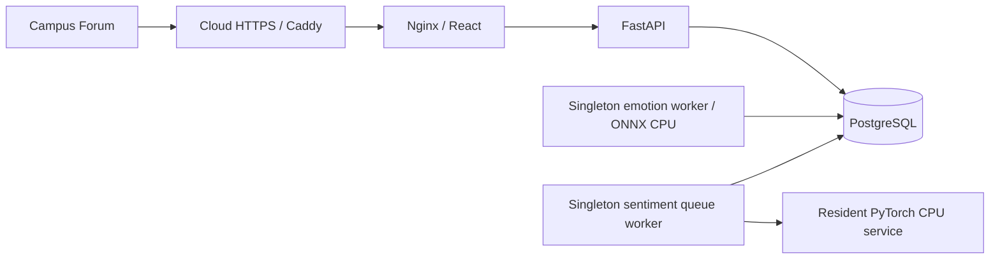

# Campus Forum

An English campus discussion forum with two independent CPU classifiers: multi-label emotion and three-class sentiment. React + TypeScript, FastAPI, PostgreSQL, ONNX Runtime CPU, PyTorch CPU, and Docker Compose.

[Live Jetstream2 demo](https://sentiment-analysis.cis240466.projects.jetstream-cloud.org/) · [Cloud deployment and measurements](docs/jetstream-dual-validation.md) · [Changelog](CHANGELOG.md)

## Product

Three discussion boards: **Halloween Haunted House**, **Campus Food**, and **DSAN Feedback**.

Register a username and password or sign in with a provisioned demo account. Browse topics, publish English posts, and check **My Posts**. The same account retains its history after signing in again, including from another browser. Admins have **Admin Dashboard** and **Performance Monitor** links in the header.

The admin dashboard shows overall and per-topic model distributions for the selected dates. Admins can create topics, filter posts, update handling status, and save separate human emotion reviews.

**Course demo.** Signed-in users share the forum. My Posts and drafts are account-specific. Anyone using the same shared demo credentials accesses that account and its history. Existing anonymous posts remain in their topics. Registering under an old display name does not claim those posts.

All interface text, validation errors, board metadata, dates, and model labels are English. User-authored content and historical reviews are retained as submitted. Models support English text only. They describe text expression, not a person's mental state or a moderation decision. No automatic removal, banning, training, or fine-tuning.

## Local startup

Requirements: Docker with Compose, Python 3 for environment setup.

```sh
sh scripts/setup.sh
# Open http://localhost:5180

docker compose ps
docker compose logs --tail 50 api worker sentiment sentiment-worker
```

The setup script creates a private `.env` with a random database password. The default web port binds only to localhost. PostgreSQL and inference services have no published ports. Initial startup downloads the pinned 125 MB ONNX and 501 MB PyTorch weights; later starts reuse persistent caches.

```sh
# Optional fictional English posts; idempotent, queued for BOTH real models
docker compose --profile tools run --rm cli python -m app.cli seed-demo

# Stop while retaining database, weights, and reports
docker compose down
# Start again
docker compose up -d
```

To provision the shared demo accounts, run:

```sh
docker compose --profile tools run --rm cli python -m app.cli seed-accounts
```

This creates `admin`, `student1`, and `student2` with initial password `123456`. Set `DEMO_ADMIN_PASSWORD` before the first provisioning to use a different administrator password. Running the command again preserves existing credentials. Password hashes use scrypt and an independent random salt.

## Demo flow

1. Sign in as `student1` or register an account, then open a topic.
2. Publish an English post; it is saved before either inference begins.
3. See emotion labels and independent positive/neutral/negative sentiment on the same post.
4. Open **My Posts** to follow your own submissions.
5. Click **Admin Dashboard** (sign in as an administrator) beside your name.
6. Inspect distributions, filter negative feedback, and mark a post **Viewed** or **Processed**.
7. Add a separate **Human review** of emotion labels; original outputs remain unchanged.
8. Open **Evaluation** to inspect separate sentiment and emotion results, per-class metrics, confusion matrices, and downloadable reports. The sentiment report is the recorded local Apple M5 full-test run, clearly labeled by environment.
9. Click **Switch to Student** to return to discussion.

## Services and data flow



A submission transaction inserts the post and both durable jobs, then returns HTTP 202. Independent workers atomically claim jobs with `FOR UPDATE SKIP LOCKED`. Each model has its own pending/processing/completed/failed state, bounded retries, and history. One model failing does not discard the post or overwrite the other output. Expired leases recover interrupted jobs; automatic attempts are capped at three before manual retry. Emotion leases last five minutes, sentiment leases three minutes.

Each model stays resident in one process. PostgreSQL advisory locks prevent accidental duplicate workers; dedicated lock connections are not pooled. API and queue transactions use bounded per-process connection pools. Models are not downloaded or loaded per request. Frontend polling is every three seconds; worker idle polling is 50 ms. Request origins are checked; cookies are HttpOnly/SameSite=Lax; SQL is parameterized and React escapes displayed text.

Migration 1 creates the original schema; migration 2 adds independent sentiment jobs/results and backfills existing posts; migration 3 updates the three boards to English forum content. Existing board IDs, posts, model scores, timestamps, and reviews are preserved. The unused historical favorites table is retained for data compatibility but has no active API or UI. Never rewrite an applied migration to upgrade an existing database.

Persistent data includes users/sessions, boards, posts, emotion/sentiment jobs and analyses, runtime versions, scores, timing, handling history, human reviews, official evaluation runs, and reports. Named volumes hold PostgreSQL, model assets, and evaluation output.

## Main API

| Endpoint | Purpose |
| --- | --- |
| `POST /api/register` | Create a student account and sign in |
| `POST/GET/DELETE /api/session` | Sign in with username/password, inspect or end session |
| `GET/POST /api/events` | List topics or create a topic as an admin |
| `POST /api/comments` | Save a post and both jobs; HTTP 202; idempotency UUID required |
| `GET /api/comments` | Pagination, board, emotion, sentiment, analysis state, handling, time range, `mine` |
| `GET /api/comments/{id}` | Post, independent outputs, and audit history |
| `POST /api/comments/{id}/retry` | Retry failed emotion analysis |
| `POST /api/comments/{id}/sentiment/retry` | Retry failed sentiment analysis |
| `PUT /api/comments/{id}/handling` | Unread/viewed/processed audit record |
| `POST /api/comments/{id}/corrections` | Append a separate human emotion review |
| `GET /api/stats` | Admin distributions with optional topic/date filters and topic summaries |
| `/api/admin/load-runs` | Admin load runs, measurements, sample traces and scoped cleanup |
| `GET /api/model`, `/api/runtime`, `/api/sentiment/runtime` | Fixed configuration and runtime information |
| `GET /api/evaluations`, `/api/evaluations/{id}` | Official emotion evaluation runs |
| `GET /api/sentiment/evaluation`, `/api/sentiment/evaluation/download` | Recorded official sentiment report and JSON download |
| `GET /api/evaluations/{id}/files/{filename}` | Saved metrics, metadata, and predictions |
| `GET /health`, `/ready` | Process health and database/both-worker readiness |

Human reviews do not overwrite model outputs, alter official test labels, or trigger training. Emotion filtering uses original labels above threshold. Sentiment statistics count one completed result per post; emotion counts may include several labels per post. Dashboard distributions use the selected dates. The top section covers all topics, and topic summaries break it down by topic. The other list filters apply only to the post list. A post counts as complete only when both models finish.

## Fixed pretrained models and sources

### Emotion

- `SamLowe/roberta-base-go_emotions-onnx`, revision `90ee0c1c4796d370e68968687b8ba51fc11224f4`.
- Author-published `onnx/model_quantized.onnx`, MIT model license. No training or local quantization.
- 28 labels: 27 emotions plus neutral. ONNX outputs logits; apply sigmoid exactly once and select **score > 0.5**. Highest score and threshold label set are separate. Empty sets stay empty; never force neutral.
- Dynamic single-text tokenization, max 512 tokens; override the published tokenizer JSON's fixed 128-token padding/truncation.
- CPUExecutionProvider only. File hashes and license evidence: [sources](docs/sources.json).

### Sentiment

- `cardiffnlp/twitter-roberta-base-sentiment-latest`, revision `3216a57f2a0d9c45a2e6c20157c20c49fb4bf9c7`.
- Author-published FP32 PyTorch weights; model card declares **CC BY 4.0**. CPU-only Torch wheels, no GPU/CUDA requirement, no conversion or quantization.
- Author preprocessing: username/link placeholders. Max 512 tokens; logits → softmax once → argmax for negative/neutral/positive. Check that classifier weights load completely.
- [Detailed provenance, full local evaluation, license boundaries](docs/cardiff-cpu-validation.md).

Models use different tasks and test sets. Scores are uncalibrated model scores, not psychological measurements. Campus-domain text, sarcasm, context, and rare emotions can cause errors. English models do not reliably analyze Chinese.

## Official quality evaluation

Emotion uses `google-research-datasets/go_emotions`, simplified/test, exactly **5,427** samples, revision `add492243ff905527e67aeb8b80c082af02207c3`, Apache-2.0. Keep all labels and samples. Report micro/macro-F1, every label's precision/recall/F1/support, and exact-match accuracy (the entire label set must match). No threshold selection on the test set.

```sh
docker compose --profile tools run --rm cli python -m app.cli evaluate
# Partial smoke only; not a complete official score
docker compose --profile tools run --rm cli python -m app.cli evaluate --limit 8
# Recompute scores from saved predictions
docker compose --profile tools run --rm cli python -m app.cli rescore /reports/evaluations/RUN_ID/predictions.jsonl
```

Reports persist in `/reports/evaluations/RUN_ID/` and are downloadable from Evaluation. CLI submits durable jobs and does not load a second serving model. Emotion evaluation allows a waiting post every 16 test samples. Official results exclude live posts, human reviews, and performance fixtures.

Sentiment's separate official TweetEval sentiment/test has **12,284** samples at revision `b3a375baf0f409c77e6bc7aa35102b7b3534f8be`. Report accuracy, micro/macro-F1, macro-recall (TweetEval's official sentiment metric), all classes, and saved predictions. The aggregate data card says `unknown`; original task terms still require verification. Do not bundle raw test tweets. This unresolved data license is separate from the clearly declared model license. The independent [CPU trial instructions](experiments/cardiff-cpu/README.md) provide full reproduction.

[Local emotion validation](docs/validation.md), [local sentiment validation](docs/cardiff-cpu-validation.md), and [Jetstream validation](docs/jetstream-dual-validation.md) remain separately labeled by hardware and version.

## Performance and tests

```sh
# Dedicated emotion benchmark; not the dual-model completion path
docker compose --profile tools run --rm cli python -m app.cli benchmark --samples 100
# Both model results required; use an isolated client container
docker compose --profile tools run --rm --no-deps -T cli python - \
  --base http://web --samples 100 --output /reports/dual-benchmark.json \
  < scripts/benchmark_dual.py
# Dedicated *_test PostgreSQL database; never production data
docker compose --profile tools run --rm tests
```

Tests cover session ownership, validation, role enforcement, load-run isolation, idempotency, independent dual outputs, filters, handling/review history, failure retries, atomic claims, interrupted-job recovery, fixed postprocessing/metrics, favorite API removal, and a non-destructive forum migration. Demo seeding queues both models idempotently. Pure-English UI/board/error checks and browser verification accompany the change.

Dual performance includes real PostgreSQL saves and both queues. The report distinguishes model inference, queue time, database completion, and client HTTP/polling observation. Batch size is 1; threads, hardware, text/token lengths, concurrency, RSS, and model revision are recorded. Performance traffic uses an excluded benchmark board. RSS sampling is not a system peak; 100% CPU means one core. Cached load/first inference excludes download time. Author reports and Mac/Jetstream measurements are separate.

## Deployment and operations

Use an independent checkout, Compose project, database, ports, and volumes. Check actual hardware and running services first. Never stop unrelated projects. The deployed instance uses `/home/exouser/sentiment-analysis`.

For the measured 16-vCPU Jetstream configuration with public HTTPS, set in private `.env`:

```dotenv
COMPOSE_FILE=compose.yaml:compose.jetstream.yaml:compose.https.yaml
PUBLIC_HOST=YOUR_PUBLIC_DNS_HOSTNAME
APP_BIND=127.0.0.1
APP_PORT=5180
APP_ORIGINS=https://YOUR_PUBLIC_DNS_HOSTNAME
COOKIE_SECURE=true
HOST_LABEL=YOUR_ACTUAL_HARDWARE
```

The overlay uses six emotion threads and four sentiment threads, with CPU budgets for API/database. These were selected from 1/2/4/6/8-thread sweeps; extra threads were not always faster. Re-measure on other hardware. The HTTPS overlay adds a seventh long-running container (Caddy), publishing TCP 80/443 while the Web debug port stays on loopback. Caddy obtains a publicly trusted certificate, redirects HTTP to the canonical HTTPS hostname, and renews certificates using persistent `caddy_data` / `caddy_config` volumes. DNS must resolve to the current VM and ports 80/443 must be reachable. Do not delete certificate volumes or commit private keys. Default local configuration remains private HTTP on 5180. Production API benchmarks must use the public HTTPS base URL so Secure session cookies are sent. See [HTTPS verification](docs/https-deployment.md).

```sh
# Start/update without removing volumes
docker compose up -d --build
curl -f http://localhost/ready
# Database backup; keep private and outside Git
mkdir -p reports/backups
docker compose exec -T db pg_dump -U campus -d campus -Fc > reports/backups/campus.dump
```

Do not use `down -v` unless explicitly intending to destroy persistent data. Keep `.env`, credentials, model caches, database dumps, and local report folders out of Git. Source code is MIT; models and datasets retain their own licenses. Historical validation snapshots describe the versions measured at that time.


## Performance Monitor

The browser demo uses your administrator session. Set `LOAD_DEMO_ENABLED=false` and recreate the API to disable new runs. Standalone CLI benchmarks still use the separate `LOAD_DEMO_CODE` in the private environment.

1. Sign in as admin and open **Performance Monitor**. Click **Run Load Demo**.
2. The browser submits 100 fixed English posts with at most 16 outstanding requests. The server accepts one run at a time, with a two-minute submission window and cooldown. The run uses the same database insert and worker queues as forum posts.
3. Switch between **Database insert to both model results** and **HTTP submit (browser measured)**. Adjust the response-time limits on the logarithmic chart. Green means excellent, yellow means good, and red means above the tolerable limit. Click a bar to inspect that sample's event log and per-model queue and inference timings. Failed HTTP requests and timeouts are counted separately.
4. Click **Clear Run**. The cleaner cancels queued work, waits for processing attempts to finish, then deletes the run's test posts, jobs, analyses and measurements. Ordinary posts and previous benchmark or evaluation reports are preserved.

Back up PostgreSQL before upgrading an existing deployment. The account migration ends anonymous sessions and preserves their posts and model outputs. The load-run migration adds isolated test records.

## Automatic topic summaries

The topic page automatically loads up to three short discussion bullets with emoji
for signed-in readers. Results are saved in PostgreSQL and shared between users.
New posts invalidate the cached summary on the next visit. The page displays
the number of posts covered. Small topics are read in full. For
larger topics it reads the newest 30 posts within a 10 KB text budget. The
classifier workers and their persisted outputs continue to operate separately.

On the local Mac, start Ollama in one terminal:

```sh
OLLAMA_HOST=127.0.0.1:11434 OLLAMA_NO_CLOUD=1 OLLAMA_NUM_PARALLEL=1 ollama serve
```

In a second terminal, with the standard local stack already running:

```sh
ollama pull qwen3.5:4b
docker compose -f compose.yaml -f compose.summary.yaml up -d --build --no-deps api web
```

The API container reaches the host through `host.docker.internal`. The
optional overlay enables the feature. It uses one generation at a time with a
55-second request timeout. To try the smaller model, pull `qwen3.5:0.8b` and
set `SUMMARY_MODEL=qwen3.5:0.8b` on the Compose command. Check important claims against the original discussion.

In a local Apple M5 run with the same 12 fictional haunted-house posts, the
short format took 4.89 s with Qwen3.5 4B (39 output tokens) and 2.14 s with
Qwen3.5 0.8B (38 output tokens). These are single runs, including model loading
when needed. The smaller model described praise of the actors as criticism.
The 4B remains the default.


**Performance Monitor → LLM Summary** shows cache hits, successful
generations, and failures from the last 100 recorded topic requests in this API
process. **Run LLM Load Test** submits eight requests using fictional posts and
a maximum concurrency of two over a single inference slot. Each sample
bypasses the application cache. Ollama can still reuse the loaded model and
prompt cache. The chart colors each sample by adjustable response-time limits.
Defaults are 100/500 ms for HTTP submission, 1/3 s for both classifier
results, and 5/10 s for LLM requests. The first limit is inclusive for
excellent, the second inclusive for good, and higher delays are poor.
These are demo display defaults and can be adjusted in each chart.
Select a bar to inspect
queue wait, model load, prompt processing, and token generation. Results are
kept in memory. **Clear LLM Run** removes the finished test only. The **Post Classifiers** tab is the default view and shows queue and inference
percentiles for both classifiers alongside the original end-to-end chart.
