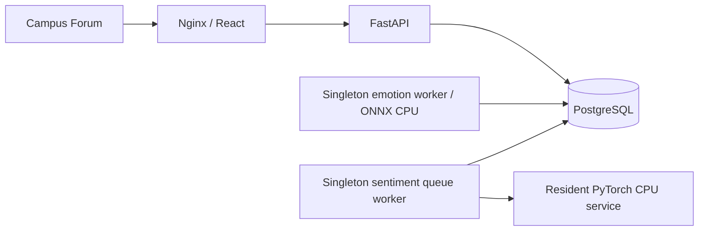

# Campus Forum

An English campus discussion forum with two independent CPU classifiers: multi-label emotion and three-class sentiment. React + TypeScript, FastAPI, PostgreSQL, ONNX Runtime CPU, PyTorch CPU, and Docker Compose.

[Live Jetstream2 demo](http://149.165.172.181/) · [Cloud deployment and measurements](docs/jetstream-dual-validation.md)

## Product

Three discussion boards: **Halloween Haunted House**, **Campus Food**, and **DSAN Feedback**.

Enter a display name without a password. Browse boards, publish English posts, and check **My Posts**. Each post shows separate emotion and sentiment results, scores, states, and retries. The **Switch to Admin** button sits immediately before the avatar and display name in the top-right corner. It opens the dashboard; **Switch to Student** returns to the forum.

The admin dashboard provides both model distributions, board/emotion/sentiment/date/status filters, viewed/processed handling, audit history, and separate human emotion reviews. Favorites have been removed from navigation, post actions, API responses, filters, and endpoints.

**Public demonstration:** the admin switch is a view mode, not authentication. Every visitor can use admin tools. A name does not verify identity. The browser cookie identifies posts from that browser; using the same name elsewhere does not recover that identity. Do not use this demo access model for real private student data.

All interface text, validation errors, board metadata, dates, and model labels are English. User-authored content and historical reviews are retained as submitted. Models support English text only. They describe text expression, not a person's mental state or a moderation decision. No automatic removal, banning, training, or fine-tuning.

## Local startup

Requirements: Docker with Compose, Python 3 for environment setup.

```sh
sh scripts/setup.sh
# Open http://localhost:5180

docker compose ps
docker compose logs --tail 50 api worker sentiment sentiment-worker
```

The setup script creates a private `.env` with a random database password. The default web port binds only to localhost. PostgreSQL and inference services have no published ports. Initial startup downloads the pinned 125 MB ONNX and 501 MB PyTorch weights; later starts reuse persistent caches.

```sh
# Optional fictional English posts; idempotent, queued for BOTH real models
docker compose --profile tools run --rm cli python -m app.cli seed-demo

# Stop while retaining database, weights, and reports
docker compose down
# Start again
docker compose up -d
```

There are no fixed demo passwords. Choose any display name. The cookie lasts up to 30 days; signing out ends that browser identity.

## Demo flow

1. Enter a display name and open a board.
2. Publish an English post; it is saved before either inference begins.
3. See emotion labels and independent positive/neutral/negative sentiment on the same post.
4. Open **My Posts** to follow your own submissions.
5. Click **Switch to Admin** beside your name.
6. Inspect distributions, filter negative feedback, and mark a post **Viewed** or **Processed**.
7. Add a separate **Human review** of emotion labels; original outputs remain unchanged.
8. Open **Evaluation** to inspect official metrics and download saved predictions.
9. Click **Switch to Student** to return to discussion.

## Services and data flow



A submission transaction inserts the post and both durable jobs, then returns HTTP 202. Independent workers atomically claim jobs with `FOR UPDATE SKIP LOCKED`. Each model has its own pending/processing/completed/failed state, bounded retries, and history. One model failing does not discard the post or overwrite the other output. Expired leases recover interrupted jobs; automatic attempts are capped at three before manual retry. Emotion leases last five minutes, sentiment leases three minutes.

Each model stays resident in one process. PostgreSQL advisory locks prevent accidental duplicate workers; dedicated lock connections are not pooled. API and queue transactions use bounded per-process connection pools. Models are not downloaded or loaded per request. Frontend polling is every three seconds; worker idle polling is 50 ms. Request origins are checked; cookies are HttpOnly/SameSite=Lax; SQL is parameterized and React escapes displayed text.

Migration 1 creates the original schema; migration 2 adds independent sentiment jobs/results and backfills existing posts; migration 3 updates the three boards to English forum content. Existing board IDs, posts, model scores, timestamps, and reviews are preserved. The unused historical favorites table is retained for data compatibility but has no active API or UI. Never rewrite an applied migration to upgrade an existing database.

Persistent data includes users/sessions, boards, posts, emotion/sentiment jobs and analyses, runtime versions, scores, timing, handling history, human reviews, official evaluation runs, and reports. Named volumes hold PostgreSQL, model assets, and evaluation output.

## Main API

| Endpoint | Purpose |
| --- | --- |
| `POST/GET/DELETE /api/session` | Display-name browser session |
| `GET /api/events` | Forum boards; internal API name retained for compatibility |
| `POST /api/comments` | Save a post and both jobs; HTTP 202; idempotency UUID required |
| `GET /api/comments` | Pagination, board, emotion, sentiment, analysis state, handling, time range, `mine` |
| `GET /api/comments/{id}` | Post, independent outputs, and audit history |
| `POST /api/comments/{id}/retry` | Retry failed emotion analysis |
| `POST /api/comments/{id}/sentiment/retry` | Retry failed sentiment analysis |
| `PUT /api/comments/{id}/handling` | Unread/viewed/processed audit record |
| `POST /api/comments/{id}/corrections` | Append a separate human emotion review |
| `GET /api/stats` | Global non-benchmark post distributions |
| `GET /api/model`, `/api/runtime`, `/api/sentiment/runtime` | Fixed configuration and runtime information |
| `GET /api/evaluations`, `/api/evaluations/{id}` | Official emotion evaluation runs |
| `GET /api/evaluations/{id}/files/{filename}` | Saved metrics, metadata, and predictions |
| `GET /health`, `/ready` | Process health and database/both-worker readiness |

Human reviews do not overwrite model outputs, alter official test labels, or trigger training. Emotion filtering uses original labels above threshold. Sentiment statistics count one completed result per post; emotion counts may include several labels per post. Dashboard distributions cover all non-benchmark posts and do not change with list filters. A post counts as complete only when both models finish.

## Fixed pretrained models and sources

### Emotion

- `SamLowe/roberta-base-go_emotions-onnx`, revision `90ee0c1c4796d370e68968687b8ba51fc11224f4`.
- Author-published `onnx/model_quantized.onnx`, MIT model license. No training or local quantization.
- 28 labels: 27 emotions plus neutral. ONNX outputs logits; apply sigmoid exactly once and select **score > 0.5**. Highest score and threshold label set are separate. Empty sets stay empty; never force neutral.
- Dynamic single-text tokenization, max 512 tokens; override the published tokenizer JSON's fixed 128-token padding/truncation.
- CPUExecutionProvider only. File hashes and license evidence: [sources](docs/sources.json).

### Sentiment

- `cardiffnlp/twitter-roberta-base-sentiment-latest`, revision `3216a57f2a0d9c45a2e6c20157c20c49fb4bf9c7`.
- Author-published FP32 PyTorch weights; model card declares **CC BY 4.0**. CPU-only Torch wheels, no GPU/CUDA requirement, no conversion or quantization.
- Author preprocessing: username/link placeholders. Max 512 tokens; logits → softmax once → argmax for negative/neutral/positive. Check that classifier weights load completely.
- [Detailed provenance, full local evaluation, license boundaries](docs/cardiff-cpu-validation.md).

Models use different tasks and test sets. Scores are uncalibrated model scores, not psychological measurements. Campus-domain text, sarcasm, context, and rare emotions can cause errors. English models do not reliably analyze Chinese.

## Official quality evaluation

Emotion uses `google-research-datasets/go_emotions`, simplified/test, exactly **5,427** samples, revision `add492243ff905527e67aeb8b80c082af02207c3`, Apache-2.0. Keep all labels and samples. Report micro/macro-F1, every label's precision/recall/F1/support, and exact-match accuracy (the entire label set must match). No threshold selection on the test set.

```sh
docker compose --profile tools run --rm cli python -m app.cli evaluate
# Partial smoke only; not a complete official score
docker compose --profile tools run --rm cli python -m app.cli evaluate --limit 8
# Recompute scores from saved predictions
docker compose --profile tools run --rm cli python -m app.cli rescore /reports/evaluations/RUN_ID/predictions.jsonl
```

Reports persist in `/reports/evaluations/RUN_ID/` and are downloadable from Evaluation. CLI submits durable jobs and does not load a second serving model. Emotion evaluation allows a waiting post every 16 test samples. Official results exclude live posts, human reviews, and performance fixtures.

Sentiment's separate official TweetEval sentiment/test has **12,284** samples at revision `b3a375baf0f409c77e6bc7aa35102b7b3534f8be`. Report accuracy, micro/macro-F1, macro-recall (TweetEval's official sentiment metric), all classes, and saved predictions. The aggregate data card says `unknown`; original task terms still require verification. Do not bundle raw test tweets. This unresolved data license is separate from the clearly declared model license. The independent [CPU trial instructions](experiments/cardiff-cpu/README.md) provide full reproduction.

[Local emotion validation](docs/validation.md), [local sentiment validation](docs/cardiff-cpu-validation.md), and [Jetstream validation](docs/jetstream-dual-validation.md) remain separately labeled by hardware and version.

## Performance and tests

```sh
# Dedicated emotion benchmark; not the dual-model completion path
docker compose --profile tools run --rm cli python -m app.cli benchmark --samples 100
# Both model results required; use an isolated client container
docker compose --profile tools run --rm --no-deps -T cli python - \
  --base http://web --samples 100 --output /reports/dual-benchmark.json \
  < scripts/benchmark_dual.py
# Dedicated *_test PostgreSQL database; never production data
docker compose --profile tools run --rm tests
```

Tests cover session ownership, validation, public-demo behavior, idempotency, independent dual outputs, filters, handling/review history, failure retries, atomic claims, interrupted-job recovery, fixed postprocessing/metrics, favorite API removal, and a non-destructive forum migration. Demo seeding queues both models idempotently. Pure-English UI/board/error checks and browser verification accompany the change.

Dual performance includes real PostgreSQL saves and both queues. The report distinguishes model inference, queue time, database completion, and client HTTP/polling observation. Batch size is 1; threads, hardware, text/token lengths, concurrency, RSS, and model revision are recorded. Performance traffic uses an excluded benchmark board. RSS sampling is not a system peak; 100% CPU means one core. Cached load/first inference excludes download time. Author reports and Mac/Jetstream measurements are separate.

## Deployment and operations

Use an independent checkout, Compose project, database, ports, and volumes. Check actual hardware and running services first. Never stop unrelated projects. The deployed instance uses `/home/exouser/sentiment-analysis`.

For the measured 16-vCPU Jetstream configuration, set in private `.env`:

```dotenv
COMPOSE_FILE=compose.yaml:compose.jetstream.yaml
APP_BIND=0.0.0.0
APP_PORT=80
APP_ORIGINS=http://YOUR_HOST,http://YOUR_IP
HOST_LABEL=YOUR_ACTUAL_HARDWARE
```

The overlay uses six emotion threads and four sentiment threads, with CPU budgets for API/database. These were selected from 1/2/4/6/8-thread sweeps; extra threads were not always faster. Re-measure on other hardware. Set `COOKIE_SECURE=true` when serving through HTTPS and include the actual HTTPS origin. Default local configuration remains private on 5180.

```sh
# Start/update without removing volumes
docker compose up -d --build
curl -f http://localhost/ready
# Database backup; keep private and outside Git
mkdir -p reports/backups
docker compose exec -T db pg_dump -U campus -d campus -Fc > reports/backups/campus.dump
```

Do not use `down -v` unless explicitly intending to destroy persistent data. Keep `.env`, credentials, model caches, database dumps, and local report folders out of Git. Source code is MIT; models and datasets retain their own licenses. Historical validation snapshots describe the versions measured at that time.
