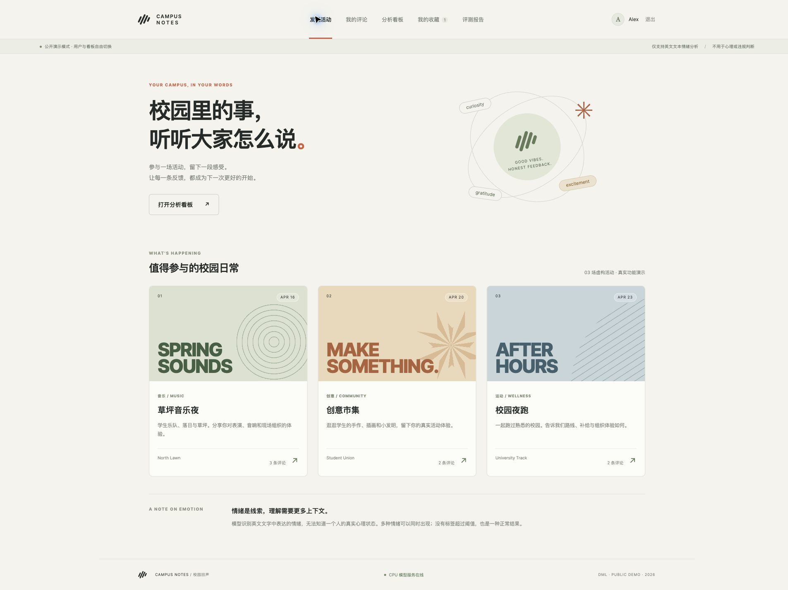
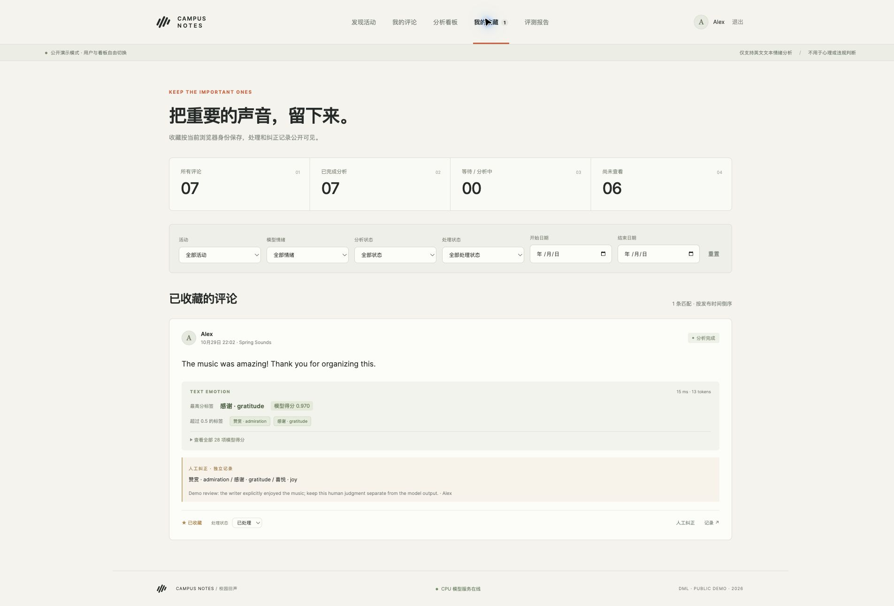

# 本地 MVP 验收记录

本次验收日期：2026-10-29（America/New_York）。执行环境为 Apple M5、16 GiB 物理内存、macOS 上的 Docker Desktop Linux/ARM64；**不是 Jetstream2 结果**。worker 容器限制为 2 CPU / 3 GB，单模型进程，batch 1，ORT intra-op 2 / inter-op 1。

## 分类评测

固定模型、固定 simplified/test 的全部 5,427 条，严格 score > 0.5。无训练、微调、量化或阈值搜索。

| 本地指标 | 结果 |
|---|---:|
| Micro-F1 | 0.589315 |
| Macro-F1（包含全部 28 类） | 0.452181 |
| Exact-match accuracy（整组标签完全一致） | 0.478902 |

[全部类别指标](results/local-evaluation/metrics.json)、[逐条真实标签及得分/预测](results/local-evaluation/predictions.jsonl)、[运行元数据](results/local-evaluation/metadata.json)。逐条预测已独立重算，得到与保存报告完全相同的全部指标。grief、pride、relief 等 F1 为 0 的类别仍完整保留。

作者 INT8 [模型卡](https://huggingface.co/SamLowe/roberta-base-go_emotions-onnx#metrics-for-quantized-int8-model)原文记录的 F1 是 0.447、Accuracy 是 0.475；这属于作者的报告，不是本机测量。这里不据差异选择模型或阈值，也不将不同执行环境的细微差异解释为算法改进。

## 性能

完整报告：[report.json](results/local-benchmark/report.json)。模型阶段固定使用官方测试集前 100 条原文，额外预热 20 次；分词、ORT 和输出处理均计入。模型服务的启动前 20 次预热不计入稳态采样。

| 本地模型指标 | 结果 |
|---|---:|
| 模型加载（已有缓存，不含下载与 Python 模块导入） | 730.99 ms |
| 首次推理（尚未预热） | 12.73 ms |
| 预热后 p50 | 10.45 ms |
| 预热后 p95 | 123.44 ms |
| 模型阶段吞吐量 | 24.83 条/秒 |
| 推理后采样最大 RSS（不是系统瞬时峰值） | 457.83 MB |
| 推理区间平均进程 CPU（100% = 一核） | 188.00% |

| API 并发 | 样本数 | 保存到完成 p50 | 保存到完成 p95 | 排队 p95 | 推理 p95 | 完成吞吐量 |
|---:|---:|---:|---:|---:|---:|---:|
| 1 | 100 | 179.91 ms | 305.13 ms | 219.88 ms | 67.93 ms | 3.22 条/秒 |
| 4 | 100 | 173.81 ms | 409.79 ms | 302.05 ms | 30.38 ms | 10.04 条/秒 |

详细报告另含 HTTP 接收响应、客户端每 100 ms 轮询观察完成的延迟、文本/token 长度分布、容器配额及 runtime ID。性能流量独立存放，公开看板只展示 7 条演示评论，不展示 200 条 API 基准评论。部署新机器后须重测，不能照搬本报告的速度。

## 功能和持久化

- 前端 TypeScript 检查及生产构建通过；9 项后端测试通过，使用独立 PostgreSQL `campus_test` 数据库。
- 浏览器完成用户名进入、活动浏览、发评论、真实分析、看板、收藏、标记处理、人工纠正和官方评测展示。
- 人工纠正单独保存，原始模型得分及标签未改变；收藏按浏览器会话隔离，公开看板操作允许所有演示访客使用。
- 测试覆盖重复提交、无效输入、Origin 检查、失败保留与三次自动尝试、手动重试、并发领取、过期租约恢复、固定 tokenizer 设置回归及多标签指标。
- 将本项目 web/api/worker 停止，重启 PostgreSQL，再启动完整项目。11 个业务表的行数与内容 SHA-256 在前后完全一致，健康检查通过。详细记录见 [persistence-check.json](results/persistence-check.json)。
- 以已保存预测独立重新计算全部指标，结果完全一致。

浏览器验收期间发现发布版 tokenizer.json 内置固定 128 padding/truncation。包装器已明确覆盖为动态 padding、512 token 上限，使用实际 attention mask；加入回归测试后才执行本报告的有效完整评测。早期未完成运行保留为失败审计记录，未纳入此成绩。

测试当前有一项第三方 Starlette/AnyIO 的弃用提示，不影响测试通过。尚未部署到新 Jetstream2 实例；没有修改旧 returnflow 服务。

## 截图

